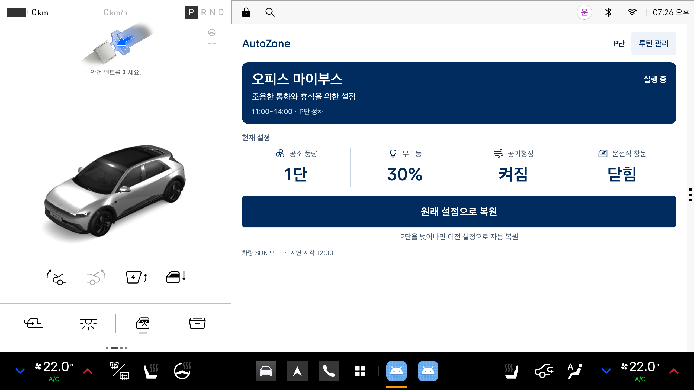

# 오토존 (AutoZone)

등록한 장소·시간대·차량 기어가 함께 맞을 때만 차량 설정을 잠시 바꾸고, 조건이 풀리면 바꾸기 전 값으로 스스로 되돌리는 Pleos Connect 차량용 앱입니다.
현대자동차그룹 차량용 앱 개발 공모전(대학(원)생 부문) 출품 프로토타입입니다.



## 대표 시나리오 · 점심 오피스 마이부스

회사 주차장(반경 70m)에서 11:00~14:00에 **P단으로 정차하면** 운전석 창문 닫힘 · 팬 1단 · 공기청정 켜짐 · 무드등 30%를 적용합니다.
적용 전 값을 기록하고, P단 해제·구역 이탈·시간대 종료·사용자 취소 시 원래 값으로 복원합니다.

| 프리셋 | 조건 | 바꾸는 설정 |
|---|---|---|
| 오피스 마이부스 | 반경 · 11:00~14:00 · P단 | 운전석 창문 · 팬 · 공기청정 · 무드등 |
| 심야 매너존 | 반경 · 22:00~06:00 | 공조 · 무드등 |
| 드라이브스루 | 반경 · 상시 | 창문 · 팬 (와이퍼 작동 시 창문 개방 보류) |
| 하교 픽업존 | 반경 · 13:00~19:00 | 2열 창문 잠금 · 공조 |

> 현재 드라이브스루에는 기어·속도 제한 조건이 없습니다. 본선에서 P단·사용자 확인 조건으로 제한할 계획입니다.

## 공개 SDK 사용처

| SDK | 사용처 |
|---|---|
| Vehicle 2.3.2 | 기어·와이퍼 확인, 풍량·무드등·공기청정·창문 읽기·쓰기·재조회 |
| FusedLocation 1.1.3 | `addProximityAlert` 구역 진입·이탈 |
| TextToSpeech 3.3.1 | 보류·복원 음성 안내 (`Mode.ON_DEVICE`) |
| AAOS `CarUxRestrictionsManager` | 루틴 관리 화면은 P단이면서 주행 제한이 없을 때만 진입 |

외부 서버나 미공개 API는 사용하지 않습니다.

## 구성

| 경로 | 내용 |
|---|---|
| [core/src/autozone/core/AutoZoneDomain.kt](core/src/autozone/core/AutoZoneDomain.kt) | Android 의존성 없는 순수 Kotlin 엔진: 지오펜스·시간대(자정 넘김)·P단 조건·스냅샷 저장/복원·우천 인터록·주행 제한 |
| [core/test/autozone/core/AutoZoneDomainTest.kt](core/test/autozone/core/AutoZoneDomainTest.kt) | 도메인 단위 테스트 8개 |
| [app/src/main/java/autozone/app/PleosAutoZoneBridge.kt](app/src/main/java/autozone/app/PleosAutoZoneBridge.kt) | Pleos Connect SDK·CarUxRestrictions 어댑터 (SDK 호출은 전용 백그라운드 스레드) |
| [app/src/main/java/autozone/app/MainActivity.kt](app/src/main/java/autozone/app/MainActivity.kt) | 차량용 화면: 홈 / 루틴 관리 / 상세 / 진단 |
| [apk/AutoZone-debug.apk](apk/AutoZone-debug.apk) | 시연에 사용한 debug APK (서명 릴리스 APK 아님) |
| [evidence/](evidence/) | 공식 에뮬레이터 D→P→D 재조회 원자료 |
| [media/AutoZone-demo-39s.mp4](media/AutoZone-demo-39s.mp4) | 제출 시연 영상 (39초, 1080p) |

## 검증 결과 (공식 Pleos_Connect_API_34 에뮬레이터)

조건: 좌표 고정, 0 km/h, 루틴 판정 시각 12:00 고정(시스템 시계와 별개인 시연 시각). 구역 EXIT 없이 기어만 D→P→D로 전환하고, 각 단계에서 Vehicle SDK getter로 다시 읽었습니다.

| SDK 재조회 | 최초 D | P · 마이부스 | 복귀 D |
|---|---:|---:|---:|
| 공조 풍량 | 4단 | 1단 | 4단 |
| 무드등 | 80% | 30% | 80% |
| 공기청정 | 꺼짐 | 켜짐 | 꺼짐 |
| 운전석 창문 | 40% | 0% | 40% |

- 원자료: [evidence/gear-readback.json](evidence/gear-readback.json), [evidence/gear-e2e-readback.log](evidence/gear-e2e-readback.log) (`READBACK` 줄), [evidence/gear-ddp-raw.mp4](evidence/gear-ddp-raw.mp4) (원본 녹화).
- 화면의 "현재 설정" 표시만으로 재조회 성공을 판정하지 않았습니다.
- 우천 화면은 창문 보류 안내와 복원 버튼 노출을 확인한 UI 검사이며, 우천 상황의 창문 값 재조회 결과가 아닙니다.

**미검증:** 실차·양산 차량, App Market 배포 권한, 확대 글꼴·다른 해상도, 앱 재시작 후 위치·설정값 유지, 장시간 백그라운드 동작.

## 빌드와 테스트

필요: JDK 17, Android SDK(API 34). Pleos SDK는 [settings.gradle.kts](settings.gradle.kts)의 Pleos Playground Maven 저장소에서 받습니다.

```powershell
# Android SDK 위치: ANDROID_HOME 설정 또는 local.properties에 sdk.dir 지정
.\gradlew.bat assembleDebug
```

도메인 단위 테스트 (JDK 17 + kotlinc):

```powershell
powershell -ExecutionPolicy Bypass -File scripts/run-core.ps1
```

시연 시각은 실행 인텐트의 `hour` 값으로 고정하고(예: `adb shell am start -n autozone.app/.MainActivity --ei hour 12`), 기어·속도·와이퍼는 에뮬레이터 Virtual Console로 바꿉니다. 배포용 빌드에서는 시연 입력 경로를 분리할 계획입니다.
